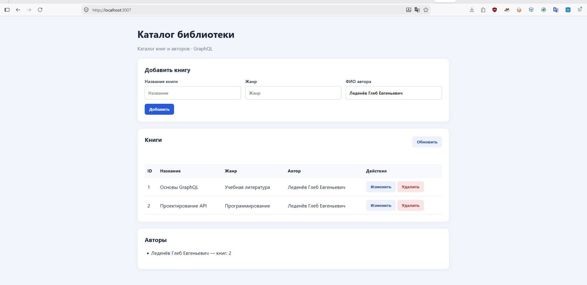
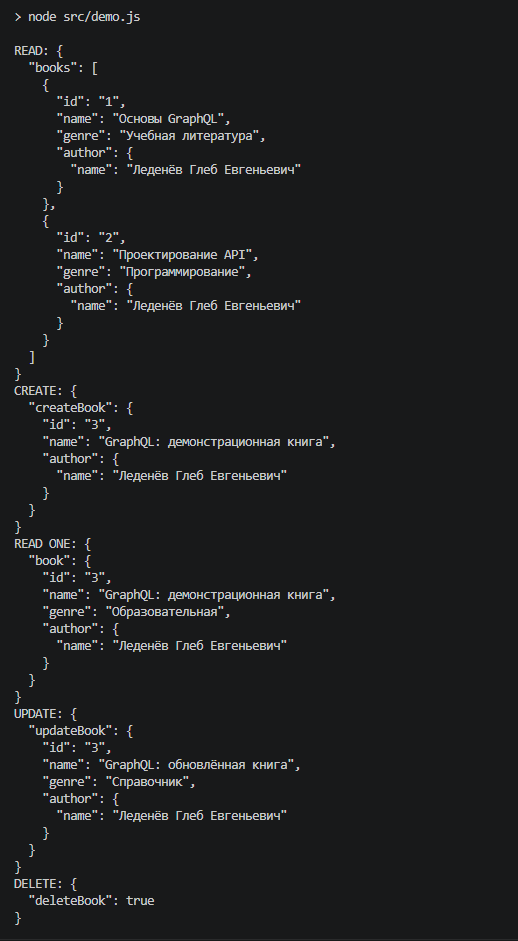
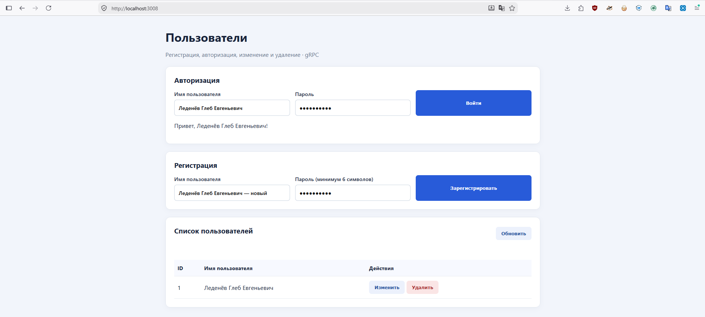
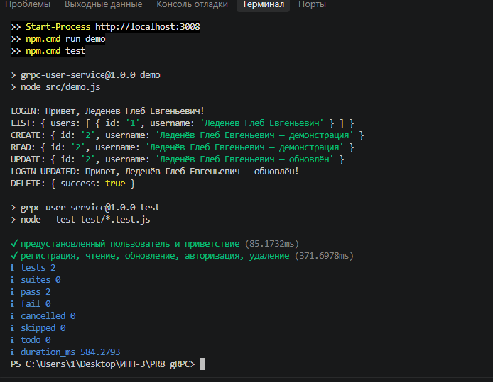

# Практические работы № 7–8 по дисциплине «Интерфейсы прикладного программирования»

**Выполнил: Леденёв Глеб Евгеньевич**

---

## Практическая работа № 7
### Введение в графовые модели интерфейсов прикладного программирования

### Цель работы

Разработать клиент-серверное приложение для хранения списка книг в библиотеке с использованием **GraphQL**, описать схему данных на языке **SDL** и проверить операции чтения и изменения данных.

### Ход работы

Для хранения информации о книгах и авторах разработана GraphQL-схема `schema.graphql`, содержащая типы `Book` и `Author`. Для книги определены идентификатор, название, жанр и автор. Схема также включает:

- `Query` — получение списка книг, конкретной книги и списка авторов;
- `Mutation` — создание, изменение и удаление книги.

Сервер реализован на **Node.js** с использованием **Express** и GraphQL. Данные сохраняются локально в JSON-файле. API доступен по адресу:

```text
http://localhost:3007/graphql
```

#### Интерфейс каталога библиотеки

Веб-клиент открыт по адресу `http://localhost:3007`. На странице отображаются две книги, сведения об авторе **Леденёв Глеб Евгеньевич**, а также элементы добавления, изменения и удаления записей.



#### Проверка GraphQL-запросов

С помощью демонстрационного клиента были последовательно выполнены операции:

- `READ` — получение списка книг;
- `CREATE` — добавление новой книги;
- `READ ONE` — получение книги по идентификатору;
- `UPDATE` — изменение книги;
- `DELETE` — удаление книги.

Для запуска демонстрации используется команда:

```powershell
npm.cmd run demo
```



### Вывод

В ходе работы реализован локальный GraphQL API для каталога библиотеки. Проверены запросы на получение данных и операции создания, изменения и удаления книг. Продемонстрировано взаимодействие веб-клиента и сервера через GraphQL.

---

## Практическая работа № 8
### Удалённый вызов процедур и программные интерфейсы в технологии gRPC

### Цель работы

Разработать клиент-серверное приложение с использованием **gRPC**, реализовать регистрацию и авторизацию пользователей, а также основные операции **CRUD**.

### Ход работы

В файле `proto/users.proto` с помощью **Protocol Buffers** описан контракт сервиса `UserService` с методами:

- `Register` — регистрация пользователя;
- `Login` — проверка логина и пароля с возвращением приветствия;
- `GetUser` и `ListUsers` — получение сведений о пользователях;
- `UpdateUser` — изменение данных пользователя;
- `DeleteUser` — удаление пользователя.

Сервер реализован на **Node.js** с использованием **gRPC**. Веб-интерфейс обращается к серверу через gRPC-клиент. Данные пользователей сохраняются локально, пароли хранятся в виде хешей.

#### Интерфейс управления пользователями

Веб-клиент открыт по адресу `http://localhost:3008`. На странице доступны регистрация, авторизация и управление пользователями. При успешной авторизации отображается сообщение:

```text
Привет, Леденёв Глеб Евгеньевич!
```



#### Проверка вызовов gRPC и тестирование

В демонстрационном клиенте выполнены вход в систему, просмотр списка пользователей, регистрация, чтение, обновление, повторная авторизация и удаление записи.

В отдельном терминале запущены команды:

```powershell
npm.cmd run demo
npm.cmd test
```

В результате автоматического тестирования получено **2 успешных теста, 0 ошибок**.



### Вывод

В ходе работы разработано локальное клиент-серверное приложение на основе gRPC. Реализованы регистрация, авторизация и CRUD-операции с пользователями. Проверена передача запросов между клиентом и сервером в соответствии с контрактом Protocol Buffers.
